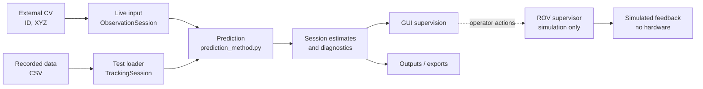

# Module architecture (editable Mermaid)

The figure below is the simplified overview used by the root README. See the [integration README](../Integration/README.md#data-flow) for timing and processing details.

**Read:** Both Test and Run use one supported prediction method, not two algorithms. Live observations are individually timestamped on receipt and update only their own ID. Recorded frames have known timing. An optional four-state supervisor uses only simulated ROV feedback; actual vehicle actuation is not implemented.
