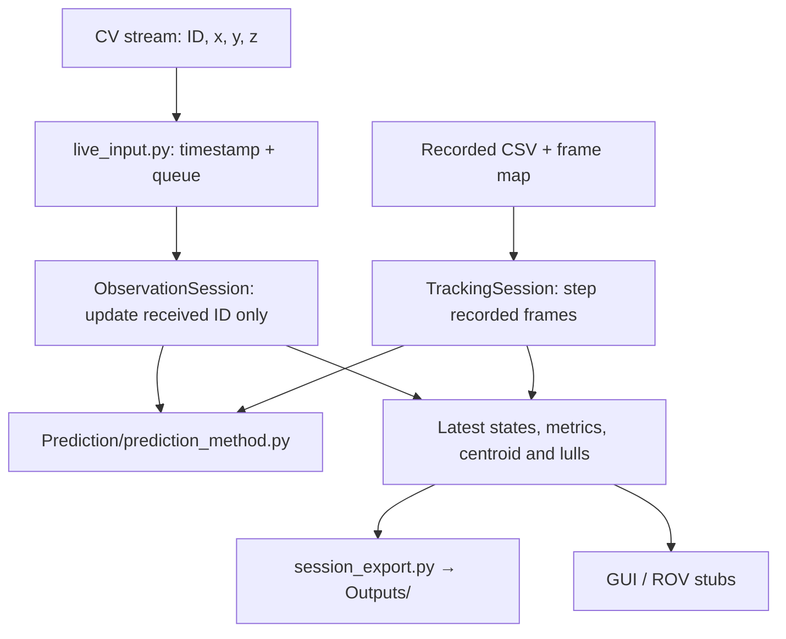

# Integration — tracking input, session analysis and ROV stubs

This layer adapts external tracking records to `Prediction/prediction_method.py`, maintains per-ID state, evaluates forecasts and provides the supervisor with diagnostics. Neither the external CV transport nor ROV actuation is implemented.

## Data flow



**Run** uses independent observation-to-observation intervals measured on receipt; **Test** uses the recorded frame time. Both manage a separate UKF for each ID and forecast the same configured duration. [Simplified system diagram](../Images/System_Architecture.svg).

| File | Responsibility |
|---|---|
| `live_input.py` | Thread-safe queue of individual `(ID, x, y, z)` observations, timestamped at receipt. Public entry: `publish_observation()`. |
| `observation_session.py` | Run-mode per-ID updates, time-based expiry, causal forecast scoring and asynchronous cluster summaries. |
| `tracking_session.py` | Test-mode `Frame` replay, CSV loaders, per-frame UKF processing, historical tracking and scoring. Shared `Snapshot`/`Score` data types. |
| `session_export.py` | Observations, UKF histories and score/summary exports to `Outputs/`. |
| `example_camera_feed.py` | Optional in-process test stream for the GUI, not a CV implementation. |
| `rov_interface.py` | Original alignment/collection placeholders; no ROV commands transmitted. |

## Live observation contract

The only assumed CV payload is `(mussel_id, x, y, z)`: a non-negative integer ID and three finite camera-relative positions **in metres**. IDs can arrive in any order and may repeat. No timestamp, camera frame delimiter or fixed delivery rate is required.

```python
from Integration.live_input import publish_observation

# Called as each new measurement becomes available (push or pull):
publish_observation(5, -0.10, 0.02, 0.42)
publish_observation(6, -0.06, 0.03, 0.44)
publish_observation(5, -0.101, 0.021, 0.420)
```

`publish_observation` is thread-safe and timestamps **at adapter receipt** using a monotonic clock. Call it after the GUI has entered Run mode; Start clears the previous queue and resets the clock origin. The GUI drains the queue and calls `ObservationSession.observe()` for every item. If the queue overflows, Run stops rather than silently producing an inaccurate timeline.

The external source can **push** records into a callback or be **polled** by an integration worker:

```python
# Example sketch; read_available is supplied by the eventual CV adapter.
for mussel_id, x, y, z in read_available():
    publish_observation(mussel_id, x, y, z)
```

There is no `finish_frame()` or batching requirement. Since no transport/API has been defined, this repository deliberately does not open a serial port, socket or camera device. If the CV system lives in a different process or machine, an adapter must receive its records and call the in-process function. The adapter must not run Tkinter calls outside the GUI thread.

## Live processing

`ObservationSession` maintains **one UKF per tracked ID**. When ID 5 arrives, only ID 5 is updated, with its own elapsed interval. ID 6 is not propagated or marked as a dropout merely because it was absent from ID 5's observation. A track expires once the time since its last observation exceeds `stale_after_s`. A later measurement of that ID starts a new filter; pending forecast scores for its old identity are discarded.

A `Snapshot` is created for each accepted input event and when an active track expires during silence. Its cluster centroid uses the last filtered positions of non-expired IDs; these positions are **not simultaneous**. `is_calm` and alignment readings are observational diagnostics only. With no frame grouping or capture timestamps, the exact frame-time centroid and wave-driven lull cannot be established. Run-mode collection is disabled until the integration has been validated; the alignment stub does not command a vehicle.

Prediction scores are formed only when a later valid measurement of the **same ID** reaches the forecast target time. If two observations bracket that target time, its position is interpolated after the second is received. No scores cross an ID-expiry gap. Arrival-time jitter and CV processing delay affect the timing accuracy.

## Recorded replay

`TrackingSession.process(Frame(index, time_s, detections))` is unchanged for Test mode. It reconstructs frames from the supplied CSVs, including the companion 15 fps tracker dump, and advances filters on each recorded timestep. The frame-based replay protocol remains available for reproducing recorded results. Its missing-frame/dropout handling is **not** applied to asynchronous Run observations.

## Handover limits

All reported spatial quantities use the camera lens-centre reference frame, not ROV body/world coordinates. ROV motor control, collection hardware, transforms, operator interlocks and emergency-stop logic remain outside this code. Consult `VARIABLE_TIMING_NOTES.md` and the final report section references in the root README.
