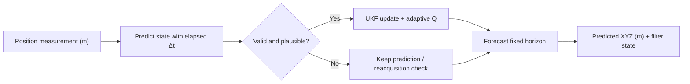

# Prediction — active UKF method

`prediction_method.py` is the **only supported predictor**. It estimates each mussel's camera-relative position and velocity and forecasts its position a fixed duration ahead. The motion equations, uncertainty model and validated default tuning values were retained when the module was renamed. See the [system architecture](../Images/System_Architecture.svg) and [integration contract](../Integration/README.md).

## Prediction pipeline



The filter state is `[x, y, z, vx, vy, vz]` (metres and m/s). The motion model exponentially damps velocity using `velocity_tau` (default 1.5 s). `P` represents state uncertainty, `Q` process uncertainty and `R` stereo measurement uncertainty. Outliers are gated using innovation statistics and distance; accepted measurements adapt the process-noise scale. Missing `(0, 0, 0)` measurements are not applied as observations.

## Public API

```python
from Prediction import prediction_method

mussel = prediction_method.predictionInstance(
    (x, y, z, mussel_id), timestep=0.1, num_timesteps=10
)
mussel.predictPositionUKF(elapsed_s=0.13)
forecast = (mussel.x_future_history[-1],
            mussel.y_future_history[-1],
            mussel.z_future_history[-1])
```

- `predictionInstance(...)` owns a private UKF, timing parameters, adaptive noise scale, histories and a copy of `UKFTuning`.
- `predictPositionUKF(elapsed_s=None)` updates with the newest measurement using the actual elapsed time in seconds (or nominal timestep when omitted), recalculates `Q` when needed, and appends a forecast without advancing the stored filter state into the future.
- `initUKF()` builds sigma points and initial covariance matrices.
- `_stateTransition`, `_processNoise` and `_retrievePredictedPosition` implement the damped-motion transition, noise discretisation and position extraction.
- `_updateWithMeasurement`, `_isOutlier`, `_isReacquisition` and `_adaptProcessNoise` implement measurement acceptance and adaptive uncertainty.

A forecast horizon is `timestep * num_timesteps` seconds. The nominal timestep sets the *forecast grid*, while `elapsed_s` sets the actual elapsed interval before the latest observation. Test mode supplies recorded-frame times; Run mode supplies time between arrivals **for the same ID**. Run-mode reception does not imply a camera frame boundary.

**Compatibility:** FilterPy is required. `Prediction/__init__.py` postpones annotation evaluation when importing this module under Python 3.9; Python 3.10+ uses a normal import. The loader only affects annotations.

## Historical research

`Archive/` retains early Fourier and method-exploration material, not an alternative supported UKF. No retired method selector or compatibility import alias is provided.

**Final report references:** Group report §§2.2, 3.2.1, 4.1.1–4.1.7 and Appendix A (Mussel Position). Documents in `Docs/` are reference-only and unchanged.
