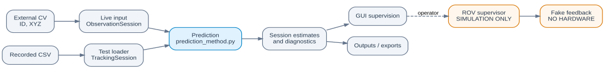

# Mussel Motion Prediction — client handover

**Status:** The active prediction method retains the validated motion/noise equations. Its timing API accepts measured elapsed intervals per mussel. The desktop panel supports recorded-frame replay and an observation-by-observation live integration point. **ROV actuation and autonomous collection are not integrated or validated.** A four-state simulation-only supervisory controller can demonstrate operator approvals, command feedback and timeouts without sending commands to a vehicle.

## What the system does

The upstream stereo computer-vision system identifies mussels and supplies their camera-relative positions and tracker IDs. For each active ID, a separate unscented Kalman filter (UKF) estimates position and velocity and predicts position a chosen time into the future. The integration layer assembles an estimated cluster centroid, reports when it appears aligned with a target, flags low-motion windows and, when recorded future observations become available, measures forecasting error.



[Editable Mermaid diagram](Images/System_Architecture.md) · [Integration data flow](Integration/README.md#data-flow) · [UKF prediction pipeline](Prediction/README.md#prediction-pipeline)

Recorded **Test** processing and asynchronous **Run** processing each own their tracking session. Both call the same `Prediction/prediction_method.py` UKF. Results are exposed to the supervisory GUI and saved to `Outputs/`; the simulated ROV sequence is separate from the UKF and cannot actuate hardware.

This repository **does not** include the stereo camera calibration/tracking service, an ROV communications stack, physical motion control, or autonomous collection hardware logic. The displayed alignment/lull information is an **advisory**, not a safe-to-collect signal. The ROV interface must be implemented and verified separately before any vehicle movement can be commanded.

## Quick start

Install **Python 3.9 or newer** and Tkinter (usually included in Windows/macOS Python; on Ubuntu/Debian install `python3-tk`). From the repository root:

```bash
python -m pip install -r requirements.txt
python -m GUI
```

On Windows, `py -m pip install -r requirements.txt` and `py -m GUI` are equivalent. Install packages into a virtual environment if desired. `filterpy` is a **required** dependency: the final UKF imports its actual implementation; no substitute UKF is silently used. On Python 3.9, `Prediction/__init__.py` postpones evaluation of the final UKF’s Python 3.10-style type annotations at import time, without editing the model. Python 3.10+ imports it normally. Tkinter requires a desktop session, so headless SSH sessions cannot display the panel without a graphical desktop.

The GUI remembers operator settings in `~/.mussel_prediction/control_panel.json`. Results go to `Outputs/` in the repository. The app launches on Windows, macOS and Linux with Python/Tkinter, although native OS testing is still recommended before client deployment.

### Test mode — recorded experiments

1. Choose **Test**, select a dataset or open a compatible CSV, and confirm the frame period (seconds) and forecast horizon (seconds).
2. Press **Start** to process frames progressively. Use **Pause**, **Step**, replay speed or the timeline to inspect earlier/later frames.
3. Explore **Scene 3D**, **Position over time**, **Accuracy**, **Motion** and **Events**. Optionally lock the cluster or select an individual mussel.
4. On completion or Stop, a new set of unit-labelled CSVs and summary JSON is saved in `Outputs/`. **Save session to Outputs/** also allows an earlier export.

Test mode retains the frame-based session; Run mode uses a separate observation-driven integration session. Both call the same UKF prediction method. It does not change the UKF's tuning or calculate forecasts using future measurements. Accuracy is evaluated only after each forecast's target-time observation arrives.

### Run mode — external tracking integration

1. Choose **Run** and press **Start**. This starts the supervisory session, not the external CV service.
2. The external source supplies **only** `(mussel_id, x, y, z)` measurements. A push callback or a pull/polling adapter calls the following once for **each** received observation:

   ```python
   from Integration.live_input import publish_observation

   publish_observation(7, -0.12, 0.03, 0.48)
   publish_observation(8, -0.09, 0.04, 0.47)
   publish_observation(7, -0.121, 0.031, 0.481)
   ```

   There is **no `finish_frame()` call**, and repeated IDs are normal. The adapter stamps the observation when it arrives using a monotonic clock. Each mussel's UKF advances only on that mussel's next observation, using time since its last observation. A disconnected tracking source leads to track expiry after the configured **ID timeout (s)**; no synthetic camera frames are invented.

   The supplied API is **in-process**, not a camera/network client. If the CV source is in another process or on another computer, implement a small transport adapter that decodes its `(ID, x, y, z)` records and calls `publish_observation()`. If data must be polled, call the same function for every record returned by each poll. See [Integration/README.md](Integration/README.md).
3. The graphs update as observations arrive. Stop saves the stream, individual predictions and evaluation metrics in `Outputs/`.
4. **Optional simulated ROV sequence:** use **Arm simulation**, then **Simulate approach** with an active target. Wait for simulated arrival and click **Approve simulated collection**; it never starts automatically. **Safe stop (simulation)** latches a FAULT until **Reset simulated fault**. No action is transmitted to the ROV. The frozen camera-relative target is illustrative only, not a verified vehicle coordinate.

The **nominal step (s)** controls the forecast discretisation, **not** an assumed camera frame rate in Run mode. The input does not provide camera capture timestamps, so arrival-time intervals may contain upstream CV/transport delay. Two different IDs received consecutively cannot be assumed to be from the same camera frame.

## Coordinate system and units

Measurements are **raw outputs of the CV tracker**, relative to the **centre of the stereo camera at the lens**. X represents left/right, Y up/down, Z forward/back. Coordinates and positions are **metres (m)**; filter velocities and calm thresholds are **metres/second (m/s)**; time and prediction horizon are **seconds (s)**. Error metrics in the GUI are shown in **millimetres (mm)** for readability; exported error columns use metres. Positive axis directions and physical target offsets must be verified when connecting the CV system; no camera-to-ROV transform is performed here.

In **Test**, a frame represents one recorded camera instant. In **Run**, observations are asynchronous and may not share a common camera frame. Each UKF uses the elapsed arrival time between measurements of its own ID. The nominal timestep controls the future-forecast grid. Variable upstream vision or communication delay cannot be corrected without capture timestamps. A zero `(0,0,0)` is treated as an invalid/dropout position.

## Repository guide

| Location | Purpose |
|---|---|
| [`GUI/`](GUI/README.md) | Current Tkinter panel, playback controls, graphs, simulation controls and operating instructions |
| [`Prediction/`](Prediction/README.md) | **Active** `prediction_method.py` with per-ID UKF and elapsed-time updates; Fourier experiments in `Archive/` |
| [`Integration/`](Integration/README.md) | CSV replay, live observations, centroid/lull advisories, exports, simulated supervisory state machine and unconnected ROV placeholders |
| [`Test_Verification/`](Test_Verification/README.md) | UKF benchmark vs zero-order hold, model exploration and standalone lull checks; unrelated experiments in `Archive/` |
| [`Data/`](Data/README.md) | Recorded real and synthetic tracking inputs and data-extraction tool |
| [`Outputs/`](Outputs/README.md) | Newly generated session observation/prediction CSVs and summaries (not source data) |
| [`Docs/`](Docs/README.md) | Submitted group report and other unchanged reference documents |
| `Images/` | Original figures; not modified |
| `tests/` | Integration-layer regression tests and instructions |
| `Data_Classes.py`, `Prediction_Result.py` | Unmodified original data records retained for historical-script compatibility |

The project exposes **one supported prediction method**. The obsolete UKF, its selectable code path, and the archived runtime/GUIs tied to it have been removed. Older unrelated Fourier and data-analysis experiments remain in their categorised archives. Reports and recorded datasets are unchanged.

## Implementation details

**Per-ID UKF:** `predictionInstance((x,y,z,ID), timestep=dt, num_timesteps=steps)` retains each instance's own nominal period and horizon. `predictPositionUKF(elapsed_s=...)` uses actual elapsed time for the update. The unchanged damped-velocity state transition, gating and adaptive noise equations are shared by both modes. Run updates **only** the ID that produced a new observation; Test updates all retained filters once per recorded frame, using the original dropout convention.

**Track retention:** Time since the last observation determines expiry. If the same ID returns after its timeout, it starts a new UKF; old history remains for review. During live silence, no artificial UKF updates occur. Forecasts are scored only when subsequent observations from the same uninterrupted ID span the future target time.

**Centroid and lull:** Test uses frame-aligned tracked positions. Run combines the most recent measurements of IDs that have not expired, so the centroid and lull indication are **asynchronous estimates**, not a simultaneous camera measurement. Lull thresholds must be validated against real tracking input and may not be used to trigger ROV actions. See [Integration/README.md](Integration/README.md).

**Forecast evaluation:** Once a forecast's target time has been reached, the system scores it against a valid observation at that time, or a target interpolated between two consecutive valid observations (only after the later one has arrived); it also compares the original measurement held constant (zero-order hold). `3D RMSE = sqrt(mean(||forecast - target||²))`. Lower is better; positive **vs. hold** percentage means the forecast beats that baseline. Scores require valid future observations and do not include missing targets. GUI plots position forecasts at their **target times**, rather than their issue times.

**Simulated ROV controller:** Independent of prediction, the optional four-state sequence is IDLE → APPROACH → COLLECT → IDLE, with latched FAULT for stop, rejected requests or timeouts. It requires operator arming and separate manual approval before simulated collection. Simulated acknowledgement/arrival/completion are generated by `Integration/rov_simulator.py`; `rov_interface.py` still contains unconnected hardware placeholders. This software stop is **not** a physical E-stop. See [Integration/README.md](Integration/README.md#simulation-only-rov-controller).

**Operator settings:** Nominal frame period, forecast horizon, ID timeout (seconds), lull speed threshold, lull window, minimum calm time, XY/Z alignment tolerances and target Z are configurable. There is no method-selection switch. The UKF's validated tuning constants are not exposed to the GUI.

For a change-by-change preservation record, see [HANDOVER_NOTES.md](HANDOVER_NOTES.md).

## Testing and handover status

For the variable-frame-timing change and limitations, see [VARIABLE_TIMING_NOTES.md](VARIABLE_TIMING_NOTES.md).

Run the non-GUI tests:

```bash
python -m unittest discover -s tests -v
```

Data parsing and live observation-buffer tests work without FilterPy; actual prediction/evaluation tests require FilterPy and are skipped with an explicit message if it is missing. The GUI also requires a graphical desktop. The provided real datasets exercise the input formats, including the 15 fps tracker log mapping. The `260721.csv` 15 fps recording spans only about 3.93 s; use a 1 s forecast horizon to obtain accuracy scores rather than the default 5 s horizon. The GUI warns when the selected horizon is too long for a recorded dataset. No on-vehicle closed-loop or real-time safety acceptance testing has been performed.

**For the report:** See the *Project Final Group Report M26 Underwater Drone 20261018.docx*: §1.2.1 (motivation), §2.2 (prediction approach), §3.2.1 (implementation), §4.1.1–4.1.7 (prediction and validation results), §5.1.1 (conclusions), and **Appendix A — Mussel Position** (detailed individual work). These are section references, not generated links. **No report files have been modified.**

## Deferred improvements for review — not implemented

These may improve eventual ROV deployment, but would alter engineering assumptions or integration architecture and require your approval and fresh validation:

1. **Completed:** Per-instance frame period and prediction horizon now isolate different sessions.
2. **Completed:** Elapsed-time UKF updates and time-based ID retention; note arrival times cannot remove unknown camera processing delay.
3. **Define a camera-to-ROV coordinate transform** and validate axis polarity, lens calibration, target offset and alignment tolerances before converting advisory targets to commands.
4. **Connect and validate real ROV control when hardware is available.** The four-state **simulation-only** controller now exercises operator approval, fake acknowledgements, completion feedback, timeouts and a latched software stop. Real feedback, motor/collection controls, safety interlocks and a physical E-stop are **not implemented**.
5. **Verify the lull detector against actual deployment sea states** and distinguish filtered sensor noise from genuine wave-driven motion before treating a lull as a collection window.
6. **Add explicit frame IDs and persistent track identity rules** to the CV contract to resolve delayed frames and ID reassignment across long dropouts.

Any further ROV control, coordinate conversion or tuning changes still require explicit review.
