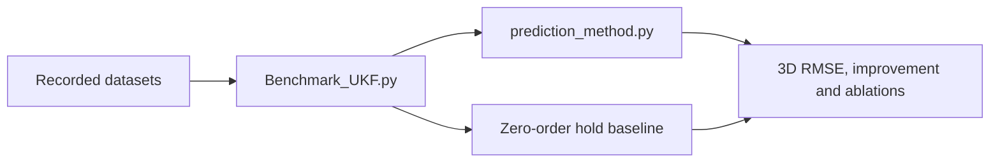

# Test and verification

These scripts evaluate the supported UKF and inspect its modelling assumptions. They are **analysis tools**, not part of the live ROV control path. Run from the repository root with the dependencies in `requirements.txt`.

| File | Purpose |
|---|---|
| `Benchmark_UKF.py` | Evaluate the active UKF against holding the last valid measurement. Includes ablations for damping, gating, adaptation and measurement noise; strict and report-style scoring remain separate. |
| `UKF_Model_Exploration.py` | Compare motion models and parameter combinations under the strict per-ID protocol. Imports the active benchmark's data and scoring helpers. |
| `Lull_Verification.py` | Visualise recorded-position speed and the calm classification at a chosen threshold. |
| `Lull_Tuning.py` | Explore adaptive lull thresholds over recorded tracks. |
| `lull_detector.py` | Standalone fixed-threshold detector extracted from historical prediction support; keeps the existing lull-analysis calculations, not an alternative UKF. |

The `Archive/` directory contains earlier non-production analysis experiments. They are retained for reference; they are not required by the GUI or active prediction system.

**Run regression tests:** `python -m unittest discover -s tests -v`. These are separate from offline benchmark plots. The supplied reports and recorded datasets were not edited.
